# 📖 Guía de Integración y Caso de Uso: Librería Digital y Carga Multimedia Compuesta

Este documento sirve como **especificación y guía técnica para desarrolladores de frontend y arquitectos de software**. Explica cómo aprovechar el ecosistema del backend monolítico (Carpetas Jerárquicas, Imágenes con Capability URLs, Documentos PDF, Tablas Abiertas con Formularios y Chat Analítico con IA) para implementar casos de uso avanzados como una **Librería o Catálogo Digital**.

---

## 🎯 1. El Problema a Resolver

En un catálogo multimedia (libros, propiedades inmobiliarias, menú de restaurantes o inventario de repuestos), cada elemento se compone de 3 tipos de recursos distintos:
1. **Un archivo binario pesado:** El documento (ej: PDF del libro de 15 MB).
2. **Un archivo visual ligero:** La portada o foto (ej: imagen JPG/PNG/WebP de 800 KB).
3. **Metadatos relacionales:** Título, autor, número de páginas, precio, categoría, etc.

### ❌ El enfoque erróneo tradicional
- Subir todo a un Excel estático, tener que descargarlo cada vez que se agrega un producto, editarlo y volverlo a subir.
- Guardar imágenes en carpetas desordenadas sin relacionarlas.
- Pedir al usuario que copie y pegue códigos a mano (alto riesgo de error tipográfico).

### ✅ La solución con este Backend: Patrón de Carga Compuesta en 1 Clic
El usuario final llena un único formulario en pantalla y pulsa un botón. El frontend coordina la subida atómica:
1. Sube la imagen y obtiene su `shortCode`.
2. Sube el PDF y obtiene su `shortCode`.
3. Registra la fila en la **Tabla Abierta (Formulario)** vinculando ambos `shortCode` automáticamente.

---

## 🏗️ 2. Arquitectura de Carpetas en 3 Niveles (Fase 20)

Para mantener una separación impecable entre proyectos y no mezclar recursos, se utiliza la jerarquía departamental:

```
Nivel 1 (Manager):  📁 juan (type: CONTAINER)
                         │
Nivel 2 (Proyecto):      └── 📁 Biblioteca Central (type: CONTAINER)  <-- Permiso EDIT al colaborador
                                  ├── 📁 Portadas (type: IMAGE)       <-- Sube imágenes
                                  ├── 📁 Libros (type: PDF)           <-- Sube PDFs
                                  └── 📁 Catalogo (type: TABLE)       <-- Tabla Abierta
```

### Ventajas clave:
* **Control Supremo:** El Manager es dueño absoluto del árbol. Si revoca el permiso a `Biblioteca Central`, el colaborador pierde acceso a todo de golpe.
* **Seguridad de Ingesta:** Las carpetas `CONTAINER` rechazan subidas directas de archivos (`400 CANNOT_UPLOAD_TO_CONTAINER_FOLDER`), forzando a que cada recurso viva en su subcarpeta tipada correspondiente.

---

## 🔄 3. Diagrama de Secuencia del Flujo de Carga

```mermaid
sequenceDiagram
    autonumber
    actor Colaborador as Colaborador (Frontend)
    participant UI as Página Carga Libros
    participant API as Monolith Backend
    participant Storage as Disco / Storage
    participant DB as PostgreSQL

    Colaborador->>UI: Llena título, autor, selecciona Portada y PDF
    Colaborador->>UI: Clic en "Guardar Libro"
    
    rect rgb(30, 41, 59)
    note right of UI: Paso 1: Subida de Portada
    UI->>API: POST /api/v1/images (file: portada.jpg, folderId)
    API->>Storage: Guarda original y genera miniatura WebP (320px)
    API->>DB: Registra shortCode 'img_a8K1'
    API-->>UI: 201 Created { shortCode: "img_a8K1" }
    end

    rect rgb(30, 41, 59)
    note right of UI: Paso 2: Subida de Libro PDF
    UI->>API: POST /api/v1/pdfs (file: libro.pdf, folderId)
    API->>Storage: Guarda PDF y extrae artefacto de texto plano
    API->>DB: Registra shortCode 'pdf_z7B2'
    API-->>UI: 201 Created { shortCode: "pdf_z7B2" }
    end

    rect rgb(30, 41, 59)
    note right of UI: Paso 3: Registro en Tabla Abierta
    UI->>API: POST /api/v1/forms/:slug/entries { titulo, autor, portada_code, libro_code }
    API->>DB: Inserta entrada en estado VALID y sincroniza fila en tabla .data.json.gz
    API-->>UI: 201 Created { entryId, status: "VALID" }
    end

    UI-->>Colaborador: "✅ Libro guardado exitosamente" + URLs públicas generadas
```



---

## 📡 4. Contratos de API para Desarrolladores

### 4.1. Autodescubrimiento de Carpetas (`GET /api/v1/folders/tree`)
Permite a la aplicación cliente consultar la estructura completa sin necesidad de quemar UUIDs en el código:
```http
GET /api/v1/folders/tree
Authorization: Bearer <token_jwt>
```
**Respuesta 200 OK:**
```json
{
  "tree": [
    {
      "id": "11111111-1111-4111-8111-111111111111",
      "name": "Biblioteca Central",
      "type": "CONTAINER",
      "children": [
        { "id": "22222222-2222-4222-8222-222222222222", "name": "Portadas", "type": "IMAGE" },
        { "id": "33333333-3333-4333-8333-333333333333", "name": "Libros", "type": "PDF" }
      ]
    }
  ],
  "total": 3
}
```

### 4.2. Carga de Portada (`POST /api/v1/images`)
```http
POST /api/v1/images
Authorization: Bearer <token_jwt>
Content-Type: multipart/form-data

file: [archivo binario JPG/PNG/WebP]
folderId: 22222222-2222-4222-8222-222222222222
```
**Respuesta 201 Created:**
```json
{
  "image": {
    "id": "img-uuid",
    "shortCode": "img_a8K1",
    "url": "https://servidor.com/i/img_a8K1",
    "width": 1200,
    "height": 1600
  }
}
```

### 4.3. Carga del PDF (`POST /api/v1/pdfs`)
```http
POST /api/v1/pdfs
Authorization: Bearer <token_jwt>
Content-Type: multipart/form-data

file: [archivo binario PDF]
folderId: 33333333-3333-4333-8333-333333333333
```
**Respuesta 201 Created:**
```json
{
  "pdf": {
    "id": "pdf-uuid",
    "shortCode": "pdf_z7B2",
    "url": "https://servidor.com/p/pdf_z7B2"
  }
}
```

### 4.4. Inserción de Fila en Tabla Abierta (`POST /api/v1/forms/:slug/entries`)
```http
POST /api/v1/forms/catalogo-libros/entries
Authorization: Bearer <token_jwt>
Content-Type: application/json

{
  "titulo": "Cien Años de Soledad",
  "autor": "Gabriel García Márquez",
  "paginas": 417,
  "categoria": "Novela",
  "portada_code": "img_a8K1",
  "libro_code": "pdf_z7B2"
}
```
**Respuesta 201 Created:**
```json
{
  "entry": {
    "id": "entry-uuid",
    "status": "VALID",
    "createdAt": "2026-11-11T03:30:00.000Z"
  }
}
```

---

## 💻 5. Implementación en Frontend (TypeScript / JavaScript)

A continuación el servicio listo para copiar y pegar en aplicaciones React, Vue, Angular o vanilla JS:

```typescript
export interface LibroDto {
  titulo: string;
  autor: string;
  paginas: number;
  categoria: string;
  archivoPortada: File;
  archivoPdf: File;
}

export class BibliotecaClient {
  constructor(
    private readonly baseUrl: string,
    private readonly token: string
  ) {}

  private get headers() {
    return { Authorization: `Bearer ${this.token}` };
  }

  async registrarLibroCompleto(dto: LibroDto, folderImgId: string, folderPdfId: string, formSlug: string) {
    // 1. Subir la imagen de la portada
    const formFoto = new FormData();
    formFoto.append('file', dto.archivoPortada);
    formFoto.append('folderId', folderImgId);

    const resImg = await fetch(`${this.baseUrl}/api/v1/images`, {
      method: 'POST',
      headers: this.headers,
      body: formFoto,
    });
    if (!resImg.ok) throw new Error('Fallo al subir la portada');
    const { image } = await resImg.json();

    // 2. Subir el archivo PDF
    const formPdf = new FormData();
    formPdf.append('file', dto.archivoPdf);
    formPdf.append('folderId', folderPdfId);

    const resPdf = await fetch(`${this.baseUrl}/api/v1/pdfs`, {
      method: 'POST',
      headers: this.headers,
      body: formPdf,
    });
    if (!resPdf.ok) throw new Error('Fallo al subir el archivo PDF');
    const { pdf } = await resPdf.json();

    // 3. Registrar entrada en la tabla abierta
    const resEntry = await fetch(`${this.baseUrl}/api/v1/forms/${formSlug}/entries`, {
      method: 'POST',
      headers: { ...this.headers, 'Content-Type': 'application/json' },
      body: JSON.stringify({
        titulo: dto.titulo,
        autor: dto.autor,
        paginas: dto.paginas,
        categoria: dto.categoria,
        portada_code: image.shortCode,
        libro_code: pdf.shortCode,
      }),
    });
    if (!resEntry.ok) throw new Error('Fallo al registrar en el catálogo');

    return {
      success: true,
      portadaUrl: `${this.baseUrl}/i/${image.shortCode}`,
      portadaThumb: `${this.baseUrl}/i/${image.shortCode}?variant=thumb`,
      libroUrl: `${this.baseUrl}/p/${pdf.shortCode}`,
    };
  }
}
```

---

## 🤖 6. Cómo Aprovecha la Inteligencia Artificial este Catálogo

Una vez que los libros están cargados mediante este flujo, el módulo de **Chat Analítico (`POST /api/v1/chat/ask`)** obtiene superpoderes:

1. **Recomendaciones Basadas en la Tabla de Catálogo:**
   - Usuario: *"Recomiéndame libros de menos de 200 páginas de literatura latinoamericana."*
   - IA: Lee la tabla del catálogo, filtra por la columna `paginas < 200` y `categoria`, y devuelve el listado con los enlaces a las portadas y libros.

2. **Lectura y Resúmenes Directos de Libros (PDF):**
   - Usuario: *"¿Cuál es la idea principal del libro 'El Principito'?"*
   - IA: Consulta el artefacto precalculado del PDF y genera un resumen exacto citando las páginas correspondientes.

3. **Gráficas Analíticas Automáticas (`chartData`):**
   - Usuario: *"Genera una gráfica comparando la cantidad de páginas de los libros más extensos."*
   - IA: Entrega la respuesta y el objeto `chartData: { labels: [...], values: [...] }` para renderizar de inmediato con Chart.js o Recharts.

### 6.1. ¿Cómo se Expone el Chat en Sitios Web Externos (React / WordPress / Vanilla)?
Para colocar el asistente de IA en la tienda o catálogo público web:

1. **Visibilidad Estricta (`ai_manager`):**
   - El endpoint público (`POST /api/v1/public/chat/ask`) **SOLO lee lo que esté en carpetas compartidas con `ai_manager`**.
   - Los archivos privados del Manager permanecen totalmente invisibles al público.
2. **Sin Tokens Secretos en Frontend:**
   - La llamada es pública: `fetch('/api/v1/public/chat/ask', { method: 'POST', body: JSON.stringify({ question }) })`.
3. **Código de Integración Rápido (Widget Flotante para WordPress o HTML):**
```html
<script>
  async function consultarIA(pregunta) {
    const res = await fetch('https://tu-backend.com/api/v1/public/chat/ask', {
      method: 'POST',
      headers: { 'Content-Type': 'application/json' },
      body: JSON.stringify({ question: pregunta })
    });
    const data = await res.json();
    console.log("Respuesta IA:", data.answer);
    if (data.chartData) console.log("Datos para gráfica:", data.chartData);
  }
</script>
```

Para ver la implementación completa en React y el widget flotante estilizado para WordPress, consulta la sección 14.3 de [`docs/frontend-integration.md`](file:///c:/Users/Windows%2011/Documents/pro-n/monolith-backend/docs/frontend-integration.md#143-ejemplo-de-widget-web-p%C3%BAblico-para-sitios-externos-react-wordpress-y-vanilla-js).

---

## 🛡️ 7. Buenas Prácticas y Manejo de Errores

* **Transaccionalidad en el Cliente:** Si el paso 2 (PDF) falla por corte de internet o tamaño excesivo (`413 PAYLOAD_TOO_LARGE`), el cliente debe abortar y notificar al usuario antes de ejecutar el paso 3.
* **Miniaturas para Rendimiento:** En la vista de cuadrícula o galería de la web, utiliza siempre `/i/:short_code?variant=thumb` (pesa ~15 KB). Usa la URL original solo cuando el usuario abra el detalle del libro.
* **Cero Códigos Manuales:** Nunca expongas campos de texto para que el colaborador escriba o pegue `shortCode` a mano. La vinculación debe ser siempre transparente y programática.

